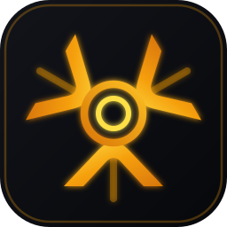

# 🎯 ThrowLab for Autodarts – Lokale Dart-Trainings-Suite



Eine schnelle, moderne und komplett lokal laufende **Trainings-Suite für [Autodarts](https://autodarts.io)** Kamera-Systeme (Windows, macOS & Linux). Verbindet sich direkt mit deinem lokalen Autodarts-Board (`http://localhost:3180`) oder lässt sich per Klick auf dem interaktiven Live-Dartboard bedienen.

---

## ✨ Enthaltene Trainingsprogramme

1. **🎯 Zielfeld-Training (Segment-Fokus)** – Konzentration auf ein wählbares Feld (`1–20` oder `Bull`)
2. **🌍 Around the World (Doppel)** – `D1 → D20 + Bull` (Vorwärts, Im Uhrzeigersinn, Rückwärts oder Zufällig)
3. **🪜 Checkout-Leiter (Up & Down)** – Start bei `41` oder beliebigem Wert (`2–170`): Checkout = `+10`, Fehlwurf = `-1`
4. **⚔️ Bob's 27** – Der Darts-Klassiker: Start mit 27 Punkten auf `D1 → D20 + Bull`
5. **✂️ Halve It** – 7 Runden (`20 → 16 → Beliebiges Doppel → 19 → 15 → Beliebiges Triple → Bull`)
6. **🏆 JDC Challenge** – Offizielles 3-Phasen-Programm (`10–15` Shanghai, alle Doppel `D1–D20 + Bull`, `15–20` Shanghai) inkl. `+100` Shanghai-Bonus & JDC-Shirt-Wertung
7. **♾️ Never Ending** – `501 Double Out` mit dynamischer Safe-Zone (`20, 19, 18, Bull` + Checkout-Felder ab `≤ 120`) und konfigurierbarer Bestrafung bei Fehlwürfen & Aus-Würfen

---

## 🚀 Features für Autodarts-Spieler

- **Echtzeit-Kamera-Koordinaten:** Zeigt jeden geworfenen Dart exakt an den von Autodarts gemessenen `(x, y)`-Koordinaten auf dem Live-Board an.
- **Smart-Zoom auf das Zielsegment:** Zoomt automatisch auf das aktuelle Ziel (und schaltet bei *Checkout-Leiter* sowie bei *Halve It – Beliebiges Doppel/Triple* automatisch auf die Vollansicht um).
- **Board-Steuerung & Quick-Menü:** Zeigt klar an, ob das Board **Aktiv**, im **Takeout (Darts ziehen)**, **Gestoppt** oder **Offline** ist – inklusive Start/Stopp, Board-Reset, DE/EN-Sprache und Dark/Light Mode.
- **Plattformübergreifender 1-Klick-Updater:** Funktioniert unter **Windows, macOS & Linux** direkt über den Browser (via `git pull` oder automatischem GitHub-ZIP-Download).

---

## 🛠️ Schnellstart (Windows, macOS & Linux)

```bash
python3 server.py
```
*(Unter Windows ggf. `python server.py`)* — danach im Browser **`http://localhost:8075`** öffnen.

---

## 🔄 Updates (Windows, macOS & Linux)

Klicke oben in der App neben dem Titel auf **`v1.3.0`** → **„🔄 Auf Updates prüfen“** → **„⬇️ Update jetzt installieren“**.
Der integrierte Updater lädt neue Versionen automatisch (per `git pull` falls über Git geklont, oder direkt als ZIP von GitHub).

---

## ℹ️ Hinweis / Disclaimer

**ThrowLab for Autodarts** ist ein inoffizielles, unabhängiges Community-Projekt und steht in keiner Verbindung zu Autodarts (weder offiziell unterstützt noch zertifiziert).  
Die App kommuniziert ausschließlich lokal mit deinem eigenen Autodarts Board Manager (`http://localhost:3180`) und greift nicht auf Cloud-APIs von Autodarts zu.

